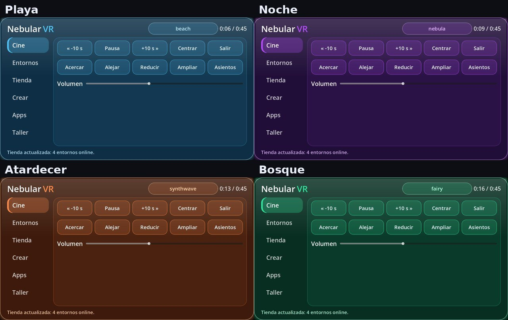

# NebularVR · Salas 3D para Meta Quest

Cine privado en realidad virtual: pantalla curva gigante, entornos 3D (playa con delfines, bosque de hadas, acuario, nebulosa…), música ambiental, panel de control con láser y perfiles por app.

> **Versión de prueba (v0.3.0).** Las versiones 0.2.0 y 0.2.1 se instalaron y arrancaron en una Meta Quest 3 real (con seguimiento de la cabeza y un mando); la **0.3.0 todavía no se ha probado en el visor** y el Release de abajo sigue siendo la 0.2.0. Qué está verificado y qué no, en [Estado conocido](#estado-conocido). Si algo falla, cuéntalo en *Issues*.

▶️ **Vídeo del recorrido:** [media/tour.mp4](media/tour.mp4)

## Entornos

| Entorno | Sala (con panel) | Paisaje |
|---|---|---|
| Playa 3D (isla con palmeras, delfines, cangrejos, gaviotas) |  |  |
| Acuario |  |  |
| Nebulosa |  |  |
| Atardecer retro |  |  |
| Jardín del Horizonte de Sucesos |  |  |
| Pantano de Lotos |  |  |
| Bosque de Hadas (gnomos, setas, hadas, troncos para sentarte) |  |  |

En los entornos normales hay **butacas de cine** con alfombra; en el bosque, **troncos**. Se pueden quitar con el botón *Asientos*.

## Qué incluye

El panel tiene un menú lateral con 8 pestañas y cuatro temas de color (Playa, Noche, Atardecer y Bosque) que cambian solos según el entorno:

- **Apps** (la primera pestaña): una rejilla de 3 × 3 con las apps instaladas en la Quest, con páginas. Tocar una app adapta la sala a su perfil (entorno, música y pantalla) y la abre; si no tiene perfil, se abre con la sala actual. *Guardar sala* hace que el siguiente toque guarde el entorno y la música actuales para esa app. *↻* recarga la lista. Fuera de la Quest, donde no hay plugin, muestra solo los perfiles guardados (*SmartTube VR 3D* viene predefinida).
- **Cine:** la pantalla curva **empieza apagada** (no gasta GPU). *Vídeo* la enciende y *Apagar* la quita; con ella encendida hay reproducir/pausar, ±10 s, acercar/alejar, tamaño, volumen y centrar. Sin vídeo, la barra superior muestra la hora.
- **Entornos:** 7 entornos con transición suave, modo ECO, música ambiental con 4 estilos (ambiente, retro, cyberpunk, clásica suave), *Ver entorno real* (passthrough) y **Batería**: el modo ahorro (activado de serie) usa 72 Hz, redibuja el panel a 15 fotogramas por segundo y quita las sombras del sol; *Batería: calidad* vuelve a 90 Hz y sombras.
- **Tienda:** entornos 360° extra desde un catálogo en GitHub.
- **Muebles:** busca muebles de [Poly Haven](https://polyhaven.com) (CC0) por categoría a través de **API-NEBULARVR**, un servicio aparte que ejecutas tú en tu red, los descarga y los coloca. Sin la API (o sin red) muestra los ya descargados.
- **Decorar:** mueve, gira y escala el mueble elegido con los botones del panel, cambia de mueble, quita, deshaz y guarda. Avisa a partir de 50 objetos o 150 000 triángulos. La decoración se guarda por entorno y se vuelve a cargar al entrar en él.
- **Taller:** ajustes de rendimiento (CPU, GPU, resolución, foveación, refresco) que se aplican por ADB desde un PC.

Si pierdes el panel de vista, **A, X, B o Y** en cualquier mando lo trae delante de ti.

En los entornos normales hay butacas de cine con alfombra; en el bosque, troncos. Se pueden quitar con el botón *Asientos*.

## Instalar (sideload)

1. Activa el **modo desarrollador** en tu Quest (app Meta Horizon en el móvil).
2. Descarga `NebularVR-test.apk` desde [Releases](../../releases).
3. Instálalo con **SideQuest** o por USB: `adb install -r NebularVR-test.apk`.
4. Ábrelo en *Aplicaciones → Orígenes desconocidos*.

Es una compilación de depuración firmada con clave de depuración, solo para pruebas.

## Estado conocido

**Verificado en una Quest 3 real** (versiones 0.2.0 y 0.2.1, instaladas por `adb` como actualización): arranca; mantiene 72 y 90 FPS estables según la frecuencia pedida; el panel aparece delante, a la altura de los ojos; la cabeza se sigue bien y se detecta el mando derecho.

**Sin verificar en el visor:**
- La versión 0.3.0 entera: modo ahorro de batería, pestañas Muebles y Decorar y recuperar el panel con A/X/B/Y.
- Que la rejilla de Apps liste las apps desde el panel y que tocar una la abra. Sí se comprobó que el APK declara los permisos de visibilidad de paquetes y que el visor tiene 116 apps con icono en el lanzador.
- El láser sobre los botones del panel, el mando izquierdo, el passthrough, la música y la Tienda online.
- Aplicar ajustes de rendimiento por ADB. Las propiedades `debug.oculus.*` son de la comunidad, no están documentadas por Meta.
- Descargar muebles desde la API real. Se probó con un mueble de prueba y servidores simulados: extracción segura del zip, carga del glTF y guardado de decoraciones.
- Mover los muebles arrastrándolos con el láser: no está hecho, se mueven con botones.

Los muebles se colocan sobre un suelo plano a la altura de tus pies; en la playa, donde la arena tiene relieve, pueden quedar algo enterrados o flotando.

No reproduce Crunchyroll, Xbox ni otras apps dentro de la sala: solo adapta la sala y abre la app.

## Licencia y créditos

El código de esta aplicación es de su autor. **No se publica el código fuente**; la app se puede usar gratis. Este repositorio solo contiene la aplicación compilada, capturas y documentación. (No es asesoramiento legal.)

Componentes de terceros incluidos en el APK:

- [Godot Engine](https://godotengine.org) 4.7.2 — MIT.
- [godot-xr-tools](https://github.com/GodotVR/godot-xr-tools) — MIT.
- [godot_openxr_vendors](https://github.com/GodotVR/godot_openxr_vendors) 5.1.0 — MIT; los componentes de Meta llevan además su propia licencia (SDK y loader de Meta).
- Base del proyecto: SmartTube-VR-3D — MIT.
- Modelos 3D de dominio público (CC0) de [Poly Pizza](https://poly.pizza): *Dolphin*, *Crab Enemy* y *Mushroom King* de [Quaternius](https://quaternius.com); *Gnome* de Polygonal Mind.
- Vídeo de demostración: *Big Buck Bunny* © Blender Foundation, [CC BY 3.0](https://creativecommons.org/licenses/by/3.0/) (peach.blender.org).
- Los muebles de la pestaña Muebles vienen de [Poly Haven](https://polyhaven.com) (CC0), descargados a través de API-NEBULARVR.
- La música ambiental se genera por código; no usa grabaciones.
