# NebularVR · Salas 3D para Meta Quest

Cine privado en realidad virtual: pantalla curva gigante, entornos 3D (playa con delfines, bosque de hadas, acuario, nebulosa…), música ambiental, panel de control con láser y perfiles por app.

> **Versión de prueba (v0.2.0-test).** Probada en simulación en PC; **todavía sin verificar en una Quest real**. Si algo falla, cuéntalo en *Issues*.

▶️ **Vídeo del recorrido:** [media/tour.mp4](media/tour.mp4)

## Entornos

| Entorno | Sala (con panel) | Paisaje |
|---|---|---|
| Playa 3D (isla con palmeras, delfines, cangrejos, gaviotas) | 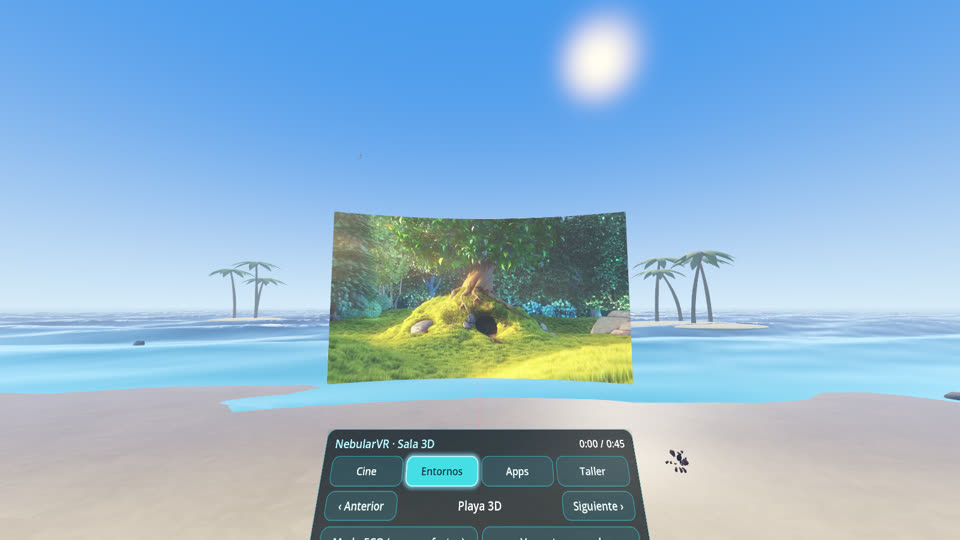 | 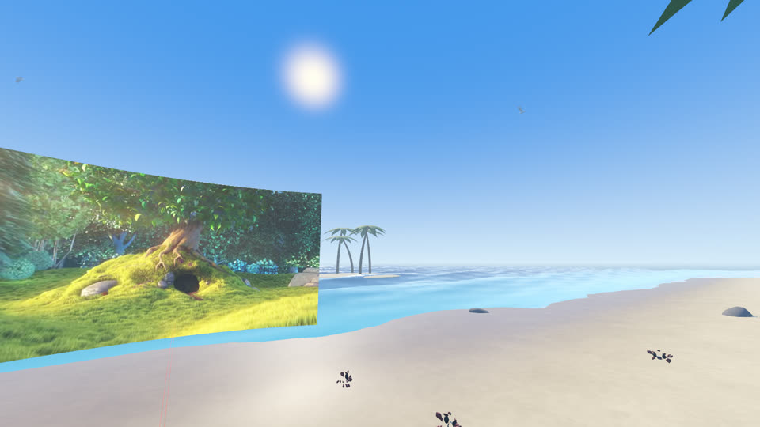 |
| Acuario | 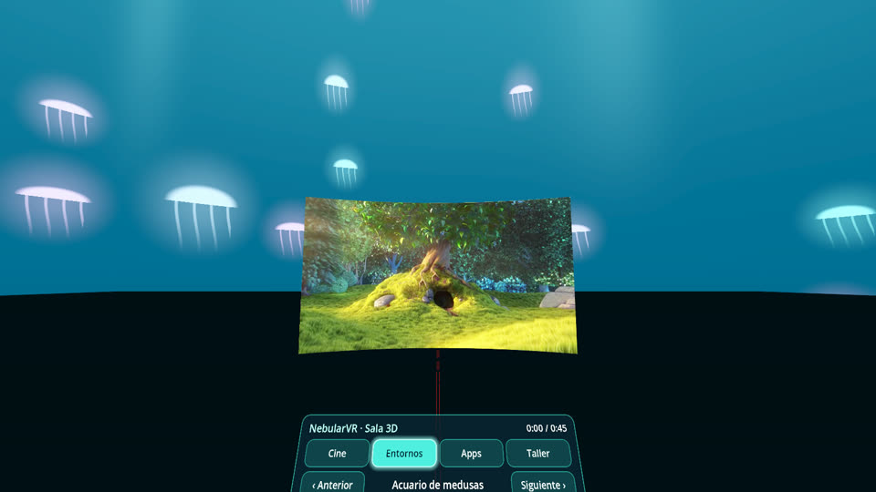 | 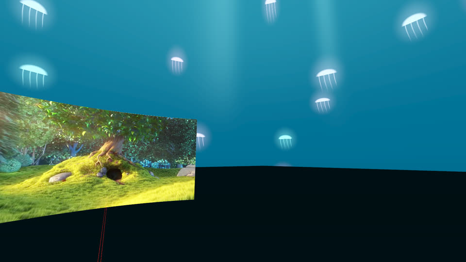 |
| Nebulosa | 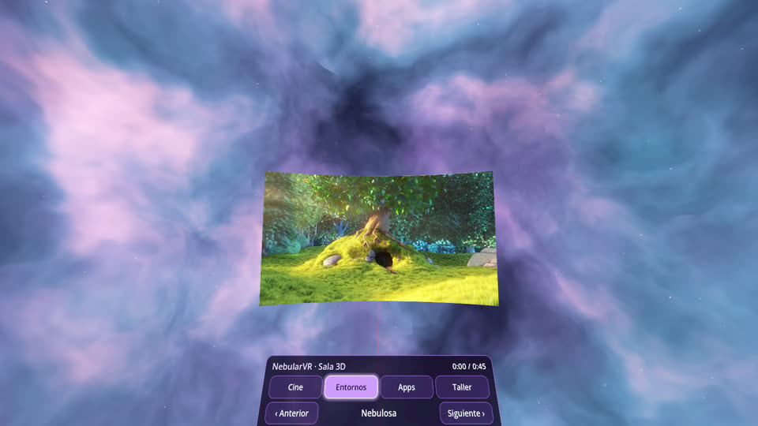 | 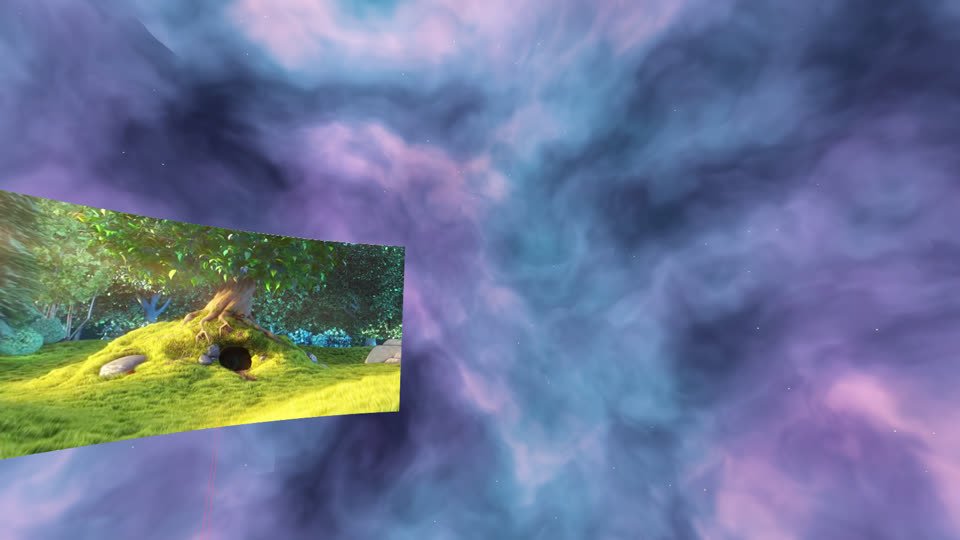 |
| Atardecer retro | 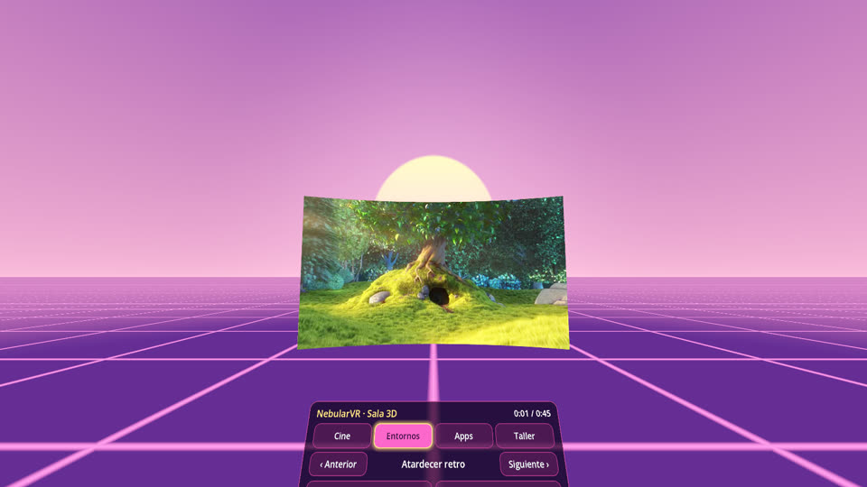 | 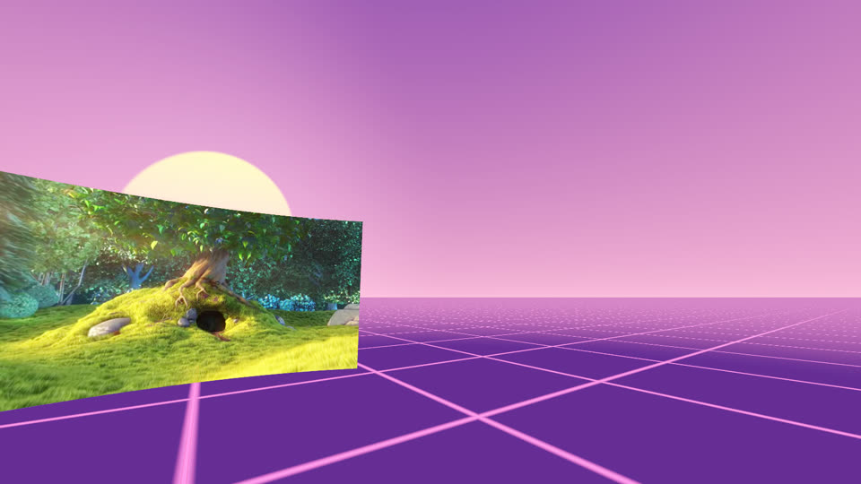 |
| Jardín del Horizonte de Sucesos | 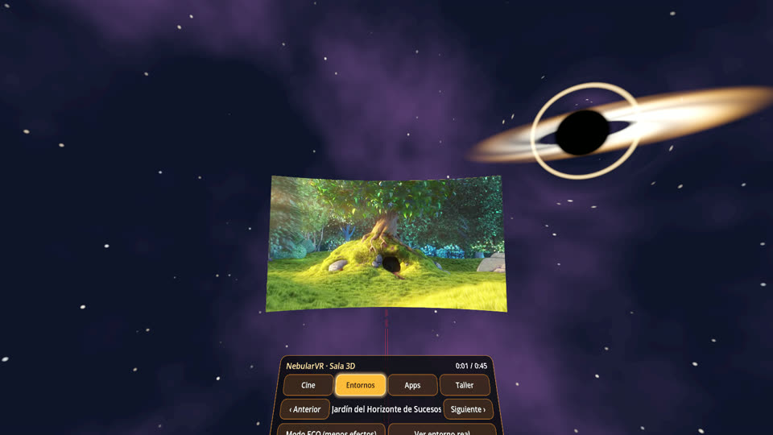 | 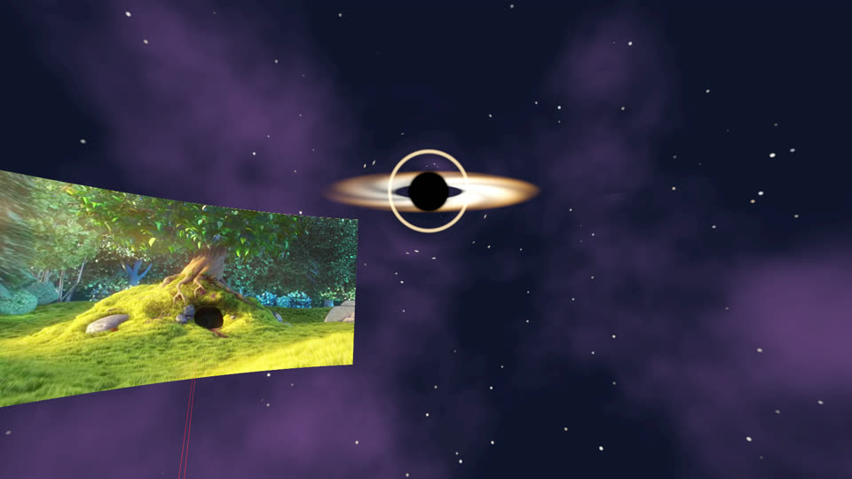 |
| Pantano de Lotos | 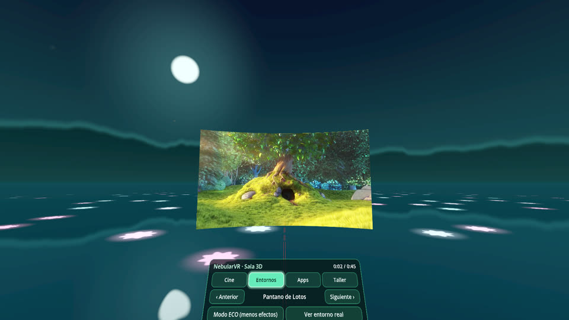 | 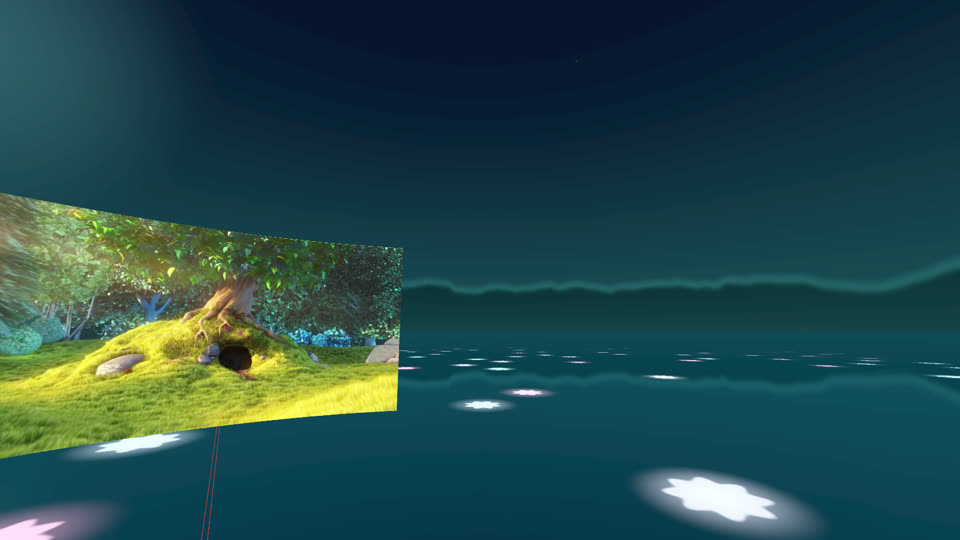 |
| Bosque de Hadas (gnomos, setas, hadas, troncos para sentarte) | 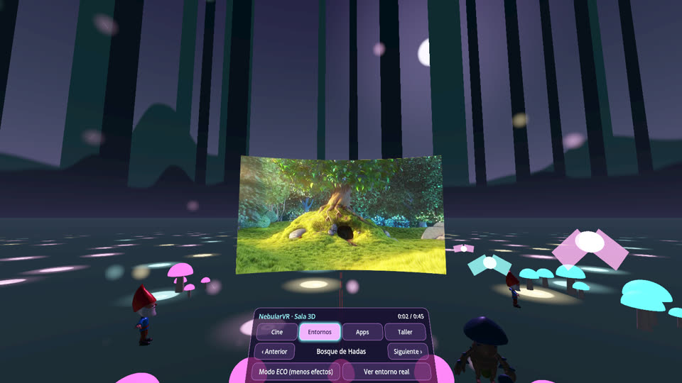 | 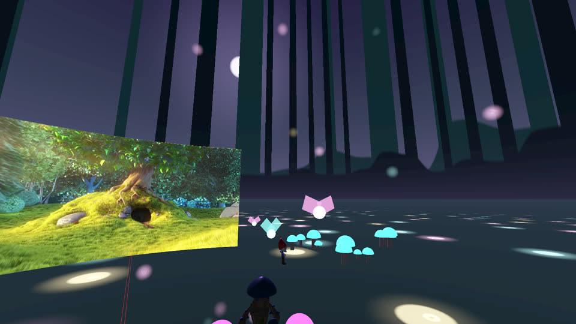 |

En los entornos normales hay **butacas de cine** con alfombra; en el bosque, **troncos**. Se pueden quitar con el botón *Asientos*.

## Qué incluye

- **Cine:** reproducir/pausar, ±10 s, acercar/alejar, tamaño de pantalla, volumen, centrar.
- **Entornos:** 7 entornos con transición suave, modo ECO, música ambiental con 4 estilos (ambiente, retro, cyberpunk, clásica suave) y botón *Ver entorno real* (passthrough).
- **Apps:** un perfil por app (entorno, música, pantalla y rendimiento). *SmartTube VR 3D* viene predefinida. En la Quest, **+ Añadir app** muestra tus apps instaladas y *Adaptar y abrir* aplica el perfil y abre la app.
- **Taller:** ajustes de rendimiento (CPU, GPU, resolución, foveación, refresco) que se aplican por ADB desde un PC.

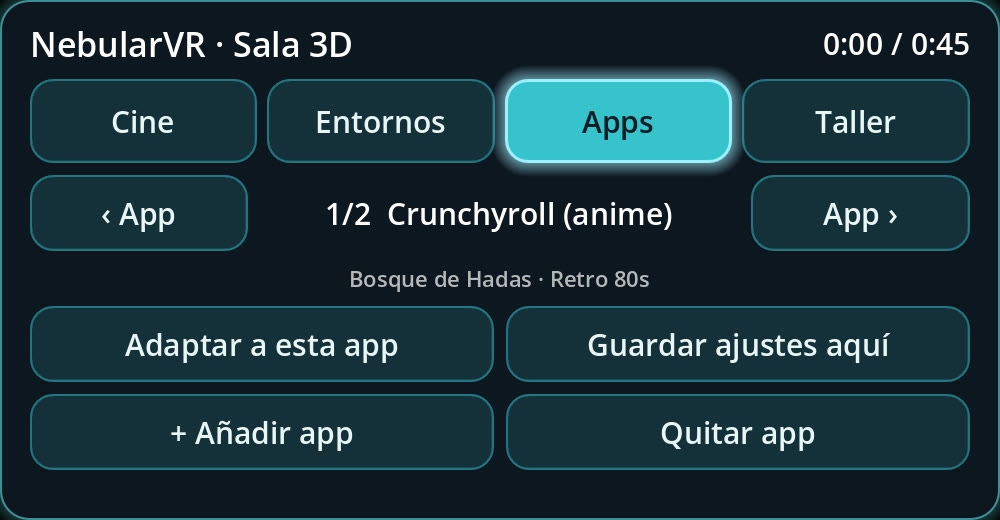

## Instalar (sideload)

1. Activa el **modo desarrollador** en tu Quest (app Meta Horizon en el móvil).
2. Descarga `NebularVR-test.apk` desde [Releases](../../releases).
3. Instálalo con **SideQuest** o por USB: `adb install -r NebularVR-test.apk`.
4. Ábrelo en *Aplicaciones → Orígenes desconocidos*.

Es una compilación de depuración firmada con clave de depuración, solo para pruebas.

## Estado conocido

- Sin verificar en Quest real: mandos y láser, rendimiento, passthrough, lista y apertura de apps, aplicar ajustes por ADB.
- Los ajustes de rendimiento (`debug.oculus.*`) son propiedades de la comunidad, no documentadas por Meta.
- No reproduce Crunchyroll, Xbox ni otras apps dentro de la sala: solo adapta la sala y abre la app.

## Licencia y créditos

El código de esta aplicación es de su autor. **No se publica el código fuente**; la app se puede usar gratis. Este repositorio solo contiene la aplicación compilada, capturas y documentación. (No es asesoramiento legal.)

Componentes de terceros incluidos en el APK:

- [Godot Engine](https://godotengine.org) 4.7.2 — MIT.
- [godot-xr-tools](https://github.com/GodotVR/godot-xr-tools) — MIT.
- [godot_openxr_vendors](https://github.com/GodotVR/godot_openxr_vendors) 5.1.0 — MIT; los componentes de Meta llevan además su propia licencia (SDK y loader de Meta).
- Base del proyecto: SmartTube-VR-3D — MIT.
- Modelos 3D de dominio público (CC0) de [Poly Pizza](https://poly.pizza): *Dolphin*, *Crab Enemy* y *Mushroom King* de [Quaternius](https://quaternius.com); *Gnome* de Polygonal Mind.
- Vídeo de demostración: *Big Buck Bunny* © Blender Foundation, [CC BY 3.0](https://creativecommons.org/licenses/by/3.0/) (peach.blender.org).
- La música ambiental se genera por código; no usa grabaciones.
